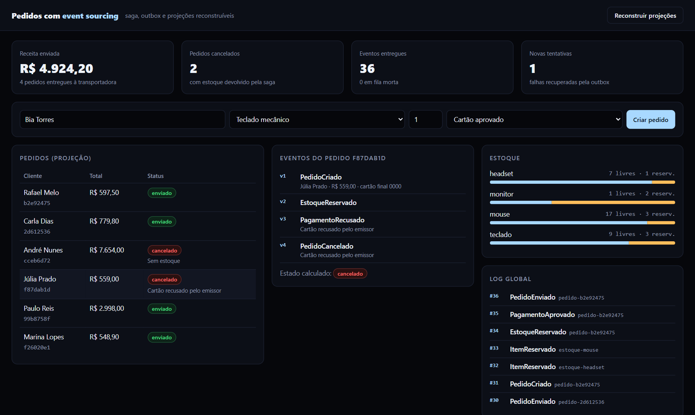
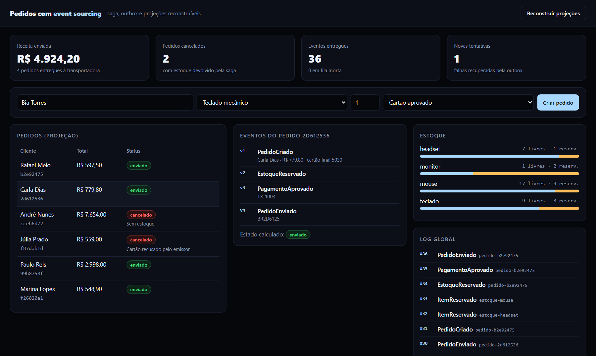
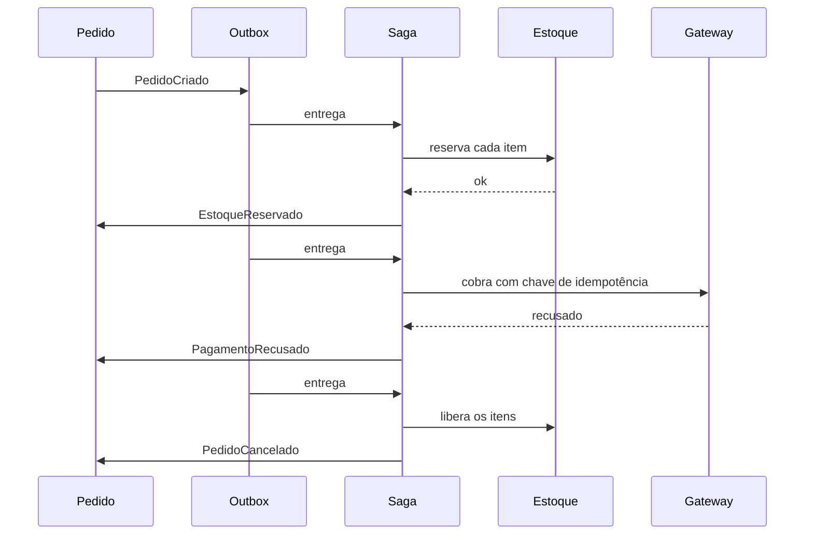
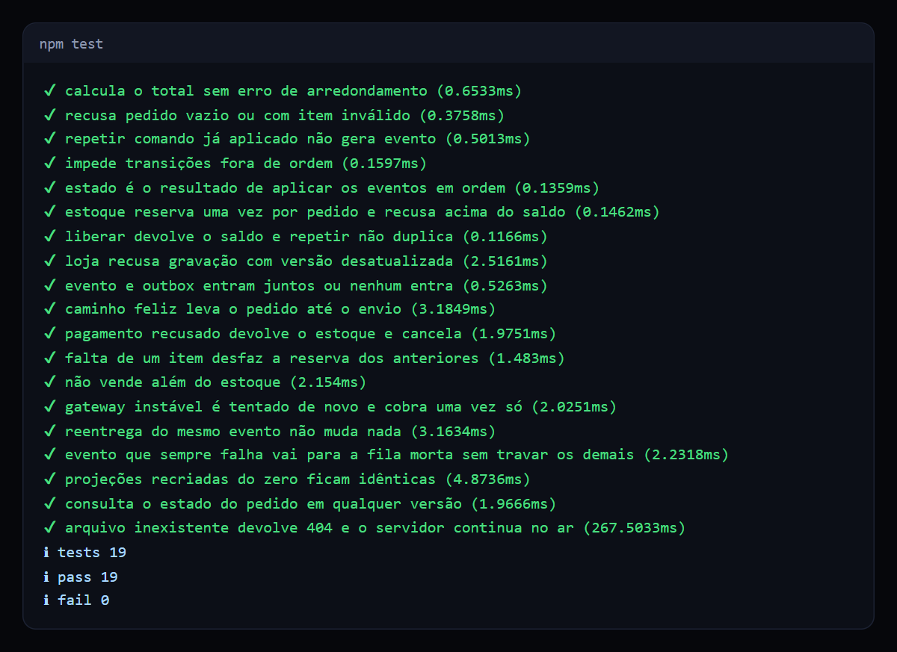

# Pedidos com event sourcing

Sistema de pedidos em que o estado é derivado de um log de eventos, com saga de compensação, outbox transacional e projeções reconstruíveis.

   

## Veja funcionando



*Pagamento recusado: a saga devolve o estoque e cancela o pedido. O histórico completo fica no log, e o estado é calculado a partir dele.*



*Gateway instável: a outbox tentou de novo, a cobrança aconteceu uma vez só e o pedido seguiu até o envio.*

## O problema

Em um e-commerce, um pedido passa por estoque, pagamento e envio. Se o pagamento falha depois de reservar o estoque, alguém precisa devolver. Se o servidor cai entre gravar no banco e avisar outro serviço, o aviso se perde. Se o aviso chega duas vezes, o cliente pode ser cobrado duas vezes.

Com uma tabela que só guarda o estado atual, também não dá para responder por que um pedido chegou até ali.

## O que ele faz

- **Event sourcing:** eventos só são incluídos, nunca alterados. O estado atual é o resultado de reaplicá-los.
- **Concorrência otimista:** gravar com uma versão desatualizada falha, e o comando relê o estado e decide de novo.
- **Saga com compensação:** reserva, cobra e envia. Em qualquer falha, desfaz o que já foi feito.
- **Outbox transacional:** evento e aviso entram na mesma transação, então nenhum dos dois se perde sozinho.
- **Entrega idempotente:** reentregar um evento não muda o resultado.
- **Fila morta:** um evento que sempre falha sai do caminho e fica visível.
- **Projeções descartáveis:** os modelos de leitura podem ser apagados e recriados a partir do log.
- **Viagem no tempo:** consulta o estado de um pedido em qualquer versão.

## Como funciona



As regras ficam em funções puras: `decidir(estado, comando)` devolve eventos e `evoluir(estado, evento)` devolve o novo estado. Repetir um comando já aplicado devolve uma lista vazia, e é isso que torna cada etapa da saga segura para reentrega.

## Decisões técnicas

| Decisão | Motivo |
| --- | --- |
| Domínio em funções puras | Regras testadas sem banco e sem simulações. |
| `UNIQUE (fluxo, versao)` no banco | A garantia de concorrência não depende só do código. |
| Idempotência em duas camadas | A tabela de processados evita trabalho, e o domínio garante o resultado se ela falhar. |
| Chamada ao gateway fora de transação | Uma transação aberta não pode esperar por rede. A chave de idempotência cobre a repetição. |
| Reserva item a item com desfazer | Cada SKU é um fluxo independente, sem trava global de estoque. |

## Como rodar

Requer Node.js 24. Não há dependências para instalar.

```bash
npm start     # painel em http://localhost:3000
npm test      # 19 testes
```

No painel, crie pedidos com cartão aprovado, recusado ou gateway instável e clique em **Reconstruir projeções** para recriar as tabelas de leitura a partir do log.

## Testes



Um dos testes apaga o controle de eventos processados e reentrega o log inteiro à saga, conferindo que nada muda. Outro recria as projeções do zero e compara com as originais.

## Limites conhecidos

- Tudo roda em um processo e um banco. Com serviços separados, a outbox publicaria em um broker como Kafka ou RabbitMQ.
- A ordem da entrega é global, o que simplifica, mas limita a vazão. O próximo passo seria particionar por fluxo.
- Não há snapshots. Com fluxos muito longos, eles evitariam reler todos os eventos.

## Estrutura

```text
src/loja.ts         log de eventos, concorrência e outbox
src/dominio.ts      regras puras de pedido e estoque
src/aplicacao.ts    comandos, saga e despacho
src/projecoes.ts    modelos de leitura reconstruíveis
src/demo.ts         gateway simulado e catálogo
public/             painel de eventos em tempo real
```

## Sobre este projeto

Projeto de demonstração, com dados e empresas fictícios, criado para mostrar a abordagem técnica.

## Autor

**Luiz Renato Carvalho**, Engenheiro de Software e IA · [luizrenato.dev](https://www.luizrenato.dev) · [LinkedIn](https://linkedin.com/in/luizrenatodc)
